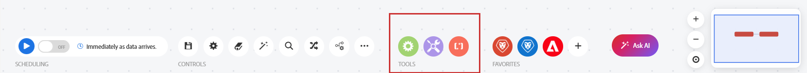
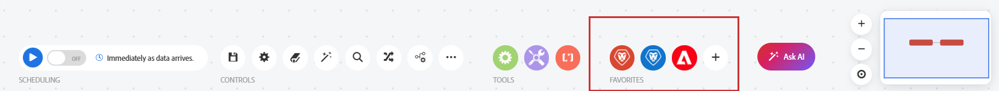

# 案例編輯器

情境編輯器可讓您在視覺介面中建立和編輯情境。

新的案例編輯器體驗：

傳統案例編輯器體驗

## 存取權要求

+++ 展開以檢視這篇文章中所述功能的存取權要求。

<table style="table-layout:auto">
 <col> 
 <col> 
 <tbody> 
  <tr> 
   <td role="rowheader">Adobe Workfront 封裝</td> 
   <td> 
任何 Adobe Workfront Workflow 封裝及任何 Adobe Workfront Automation and Integration 封裝

Workfront Ultimate

Workfront Prime 和 Select 封裝，以及額外購買的 Workfront Fusion。
 </td> 
  </tr> 
  <tr data-mc-conditions=""> 
   <td role="rowheader">Adobe Workfront 授權</td> 
   <td> 
標準

工作或更高層級
 </td> 
  </tr> 
  <tr> 
   <td role="rowheader">產品</td> 
   <td>
   
如果您的組織擁有 Select 或 Prime Workfront 封裝，但不包括 Workfront Automation and Integration，則您的組織必須購買 Adobe Workfront Fusion。</li></ul>
   </td> 
  </tr>
 </tbody> 
</table>

若要詳細了解此表格中的資訊，請參閱[&#128279;](/help/workfront-fusion/references/licenses-and-roles/access-level-requirements-in-documentation.md)文件中的存取權要求。

+++

## 全新和傳統體驗

Workfront Fusion正在將案例編輯器轉換為新體驗。 在此轉換期間，傳統體驗和新體驗皆可使用，而且您可以隨時在它們之間切換。 我們建議您使用新體驗。

新體驗包括：

* 重新設計的畫布，包含卡片樣式的模組、迷你地圖和縮放控制項。
* 新的情境編輯器控制項，包括尋找和取代、代碼片段及還原/重做。
* 詢問AI按鈕。
* 更新的聯結器選擇器，具有類別導覽及將我的最愛標示為內嵌的功能。
* 遵循外觀設定的深色模式。
* 摺疊路由器以隱藏路由的功能。
* [即時軌跡](/help/workfront-fusion/manage-scenarios/live-trail.md)，顯示實際執行情境的面板。
* 情景編輯器中現在內建了數個開發人員工具。
* 臨時偵錯記錄，您可以在情境設定中開啟此功能。

若要在傳統體驗和新體驗之間切換：

1. 在情境編輯器中，在右上角找到&#x200B;**[!UICONTROL 嘗試新設計]**&#x200B;切換按鈕。
1. 按一下切換即可切換至新體驗。
1. 若要返回傳統體驗，請再次按一下切換按鈕。

切換時，場景會重新載入。 您的選擇會為使用者儲存，因此不會改變您的團隊成員看到的體驗。 切換不會變更案例本身。

如果您沒有看到切換，則可能是您的組織尚未可以使用新體驗。 請連絡您的Workfront Fusion管理員。

## 在新體驗中使用案例編輯器（建議）

* [開啟案例編輯器並新增模組：](#open-the-scenario-editor-and-add-a-module)
* [可用的案例編輯器動作](#available-scenario-editor-actions)

### 開啟案例編輯器並新增模組：

1. 按一下左側面板中的&#x200B;**[!UICONTROL 案例]** 。
1. 按一下預留位置模組，開啟應用程式和服務清單。
1. 選取您想要開始使用的應用程式或服務：

   * 使用左側的面板依類別瀏覽（[!UICONTROL 我的最愛]、[!UICONTROL 所有應用程式]、[!UICONTROL Adobe Workfront]、[!UICONTROL Adobe Firefly Services]、[!UICONTROL Adobe Creative與內容]、[!UICONTROL Adobe Cloud Services]、[!UICONTROL Generative AI]或[!UICONTROL 內建]）。
   * 在搜尋方塊中輸入字詞以篩選清單。
   * 若要將聯結器新增至您的最愛，請將游標移至聯結器上，然後按一下聯結器旁的星形圖示。

   如需設定模組的詳細資訊，請參閱[設定模組](/help/workfront-fusion/create-scenarios/add-modules/configure-a-modules-settings.md)。

### 可用的案例編輯器動作

* [編輯動作](#editing-actions)
* [排程](#scheduling)
* [控制項](#controls)
* [工具](#tools)
* [我的最愛](#favorites)
* [詢問AI](#ask-ai)
* [畫布導覽](#canvas-navigation)
* [畫布顯示](#canvas-display)

#### 編輯動作

這些動作可在熒幕上方使用，而非在底部工具列中使用。

| 動作 | 詳細資料 |
| ---------- | ---------- |
| 案例名稱 | 情境的名稱會顯示在畫面的左上方。 若要重新命名案例，請按一下名稱並輸入新名稱。 |
| 精簡檢視 | 將畫布上的模組縮小為小圖磚、格線變窄，以及長模組名稱換行而非截斷的檢視切換為顯示。 切換檢視不會重新載入情境。 |
| 意見反應 | 傳送新體驗的意見反應。 此按鈕位於情境編輯器的右上角，在「緊密」檢視切換開關旁。 |
| 復原  | 復原最近的動作，最新的動作會先復原。 您只能從目前作業階段復原動作。 |
| 取消復原  | 重做最近的動作。 您只能重做目前工作階段的動作。 |
| 歷程記錄  | 檢視此工作階段中所做變更的歷史記錄。 您也可以復原所有作業階段變更。 |

#### 排程

| 動作 | 詳細資料 |
| ---------- | ---------- |
| 執行一次 | 執行一次在新設計中是僅限圖示。 將游標停留在圖示上以檢視&#x200B;**[!UICONTROL 執行一次]**&#x200B;工具提示。 在啟用案例之前，您可以在此測試執行案例，並確認案例能如預期般執行 |
| 啟用切換 | 啟用或停用您的情境。 啟用後，情境將根據其排程執行。 |
| 排程情境 | 依預設，具有輪詢觸發器的案例每15分鐘執行一次。 您可以定義已啟動案例執行的時間和頻率，以變更此專案。 輪詢的融合案例可以排程為每5分鐘執行一次。 如需詳細資訊，請參閱[排程情境](/help/workfront-fusion/create-scenarios/config-scenarios-settings/schedule-a-scenario.md)。 |

#### 控制項

您可能需要按一下「控制項」區域中的三點圖示，才能檢視其中的部分控制項。

| 動作 | 詳細資料 |
| ---------- | ---------- |
| 儲存 

 | 
儲存您的情境後，三點選單底下將顯示新版本，以備您日後需要存取時使用。 先前儲存的案例版本可在建立下一個案例版本後的60天內使用。 

為了保留超過60天的案例版本歷史記錄以供稽核，我們建議將案例的藍圖儲存並封存到其他位置。
 |
| 案例設定 

 | 情境設定面板包含情境的進階設定。 如需有關可用設定的詳細資訊，請參閱[設定案例設定](/help/workfront-fusion/create-scenarios/config-scenarios-settings/configure-scenario-settings.md)。 不會保留每次執行的要求和回應詳細資料。 若要收集案例的定期執行，請開啟暫存偵錯記錄。 如需詳細資訊，請參閱[暫時的偵錯記錄檔](/help/workfront-fusion/create-scenarios/config-scenarios-settings/configure-scenario-settings.md#temporary-debug-logs)。 |
| 附註 

 | 記錄情境。 其他使用者在情境中時可以檢視這些附註。 如需詳細資訊，請參閱[將附註新增至情境](/help/workfront-fusion/create-scenarios/config-scenarios-settings/add-notes-to-scenario.md)。 |
| 自動對齊 

 | 自動對齊案例中的模組。 |
| 搜尋模組 

 | 從該清單中選取一個模組，移至情境中的該模組，或輸入搜尋字詞以找出模組，然後按一下要帶到該模組的搜尋結果。 您可以依模組名稱、ID、型別或應用程式來搜尋。 |
| 尋找並取代 

 | 
在情境的模組中搜尋並取代變數、對應的值來源或連線。 使用標籤可以：
<ul><li>在整個案例或一個模組中取代對應變數。</li><li>將參考從一個來源模組重新對應到另一個來源模組。</li><li>將連線從相同應用程式複製到一或所有相容的模組。</li></ul>
在您進行變更之前，面板會預覽將受影響的模組。 在預覽中選取一列，以前往畫布上的該模組。
 
如需詳細資訊，請參閱[尋找和取代情境中的變數、來源和連線](/help/workfront-fusion/manage-scenarios/find-and-replace.md)。
 |
| 程式碼片段 

 | 
程式碼片段是儲存為單位的案例區段。 若要建立模組，請選取模組並將其儲存為程式碼片段。 在「程式碼片段」面板中，您可以搜尋、標籤、預覽、釘選、排序及拖放程式碼片段，以及匯入和匯出程式碼片段。 您可以與團隊或組織共用代碼片段，或直接將副本傳送給其他使用者。 共用的程式碼片段會顯示在自己的標籤上。
 
如需詳細資訊，請參閱[儲存及重複使用包含程式碼片段的案例區段](/help/workfront-fusion/create-scenarios/add-modules/use-snippets.md)。
 |
| 說明流程 

 | 檢視移動點顯示資料如何流經情境的動畫。 |
| 匯出Blueprint 

 | 匯出目前案例的藍圖。 如需詳細資訊，請參閱[複製模組或案例](/help/workfront-fusion/create-scenarios/add-modules/copy-modules-or-scenarios.md)。 |
| 匯出為Headless範本 

 | 將情境匯出為Headless範本。 |
| 匯入Blueprint 

 | 匯入先前匯出的情境藍圖。 如需詳細資訊，請參閱[複製模組或案例](/help/workfront-fusion/create-scenarios/add-modules/copy-modules-or-scenarios.md)。 |
| DevTool 

 | 使用DevTool，您可以檢查案例的所有手動執行、檢閱所有已執行的操作，並檢視每個已執行API呼叫的詳細資訊。 您可以檢視導致錯誤的模組、操作或單一回應，並運用該知識來調整您的案例。 如需詳細資訊，請參閱[偵錯案例](/help/workfront-fusion/manage-scenarios/debug-a-scenario.md)。 |
| 先前版本 

 | 檢視此情境的早期版本。 如需詳細資訊，請參閱[檢視和管理案例版本](/help/workfront-fusion/manage-scenarios/restore-a-scenario-version.md)。 |

#### 工具

| 動作 | 詳細資料 |
| ---------- | ---------- |
| 流量控制 | 設定設定以控制資料流經情境的方式。 如需詳細資訊，請參閱[流量控制](/help/workfront-fusion/references/apps-and-modules/tools-and-transformers/flow-control.md)。 |
| 工具 | 工具區段包含數個可增強案例的實用模組。 如需詳細資訊，請參閱[工具](/help/workfront-fusion/references/apps-and-modules/tools-and-transformers/tools-modules.md)。 |
| 文字剖析器 | 使用文字剖析器工具來剖析文字，以用於其他案例模組。 如需詳細資訊，請參閱[文字剖析器](/help/workfront-fusion/references/apps-and-modules/tools-and-transformers/text-parser.md)。 |

#### 我的最愛

您可以使用我的最愛圖示來新增您經常使用的模組。

| 動作 | 詳細資料 |
| ---------- | ---------- |
| 您最愛的聯結器 | 您標示為我的最愛的聯結器會顯示在這裡。 |
| 新增我的最愛圖示 | 按一下此圖示可選取另一個聯結器以新增至我的最愛區段。 |
| 「溢位」圖示 | 如果您有超過工具列所能容納數量的我的最愛，則會顯示一個溢位（三點）圖示，讓您能夠存取其餘的我的最愛。 |

#### 詢問AI

按一下&#x200B;**詢問AI**&#x200B;以開啟Adobe的AI助理。 根據您組織的AI設定，此選項可能無法使用。

#### 畫布導覽

| 動作 | 詳細資料 |
| ---------- | ---------- |
| 放大/縮小 | 放大或縮小畫布檢視。 |
| 聚焦 | 返回熒幕上適合您整個情境的檢視。 |
| 迷你地圖 | 檢視整個情境的縮圖概觀。 迷你地圖會顯示您目前的檢視區。 在畫布內按一下，或按一下並拖曳，以在畫布周圍移動。 |

#### 畫布顯示

新畫布也會變更您工作時的情境外觀。

| 功能 | 詳細資料 |
| ---------- | ---------- |
| 模組卡片 | 每個模組都是一張水準卡片，可顯示應用程式圖示、模組名稱、說明和模組ID。 路由器會顯示為精簡的分支圖磚，而指令會顯示為小型強調文字卡。 |
| 連結 | 模組之間的連結是彎曲的，並以顯示方向的箭頭結尾。 錯誤處理常式連結以虛線顯示。 |
| 模組狀態 | 綠色、黃色和紅色指示器會顯示每個模組的狀態。 |
| 縮放詳細資料 | 當您放大顯示卡片詳細資訊。 縮小顯示時，模組會簡化為圖示，讓您仍可看到整個情境。 |
| 摺疊路由器 | 在編輯模式中，您可以摺疊路由器以隱藏其路由。 如需詳細資訊，請參閱[摺疊路由器](/help/workfront-fusion/create-scenarios/add-modules/router-module.md#fold-a-router)。 |
| 深色模式 | 畫布會遵循Adobe偏好設定下的深色外觀設定，包括模組卡片、連結、面板、控制項和狀態資訊。 |
| 右側面板 | 模組設定、模組檢查、模組瀏覽器、尋找和取代、程式碼片段、[即時軌跡](/help/workfront-fusion/manage-scenarios/live-trail.md)以及要求和回應詳細資訊會在畫布右側的同一面板中開啟。 |

## 使用傳統體驗中的案例編輯器

* [開啟案例編輯器並新增模組： (Classic)](#open-the-scenario-editor-and-add-a-module-classic)
* [可用的案例編輯器動作（傳統）](#available-scenario-editor-actions-classic)

### 開啟案例編輯器並新增模組： (Classic)

1. 按一下左側面板中的&#x200B;**[!UICONTROL 案例]** 。
1. 按一下問號圖示，然後尋找並按一下您要開始使用的應用程式或服務。 如需設定模組的詳細資訊，請參閱[設定模組](/help/workfront-fusion/create-scenarios/add-modules/configure-a-modules-settings.md)。

### 可用的案例編輯器動作（傳統）

* [執行您的案例（傳統）](#run-your-scenario-classic)
* [排程（傳統）](#scheduling-classic)
* [控制項（傳統）](#controls-classic)
* [工具（傳統）](#tools-classic)
* [我的最愛（傳統）](#favorites-classic)

#### 執行您的案例（傳統）

| 動作 | 詳細資料 |
|----------|----------|
| 測試執行情境 | 在啟用情景之前，請驗證情景是否以您預期的方式執行。 一旦啟用，情境將會根據其排程執行。 如果一切未如預期般執行，請參閱[新增錯誤處理](/help/workfront-fusion/create-scenarios/config-error-handling/error-handling.md)以瞭解如何處理錯誤。 |

#### 排程（傳統）

| 動作 | 詳細資料 |
| ---------- | ---------- |
| 排程情境 | 依預設，一個案例每15分鐘執行一次。 您可以定義已啟動案例執行的時間和頻率，以變更此專案。 融合情境可以排程為每5分鐘執行一次。 如需詳細資訊，請參閱[排程情境](/help/workfront-fusion/create-scenarios/config-scenarios-settings/schedule-a-scenario.md)。 |

#### 控制項（傳統）

您可能需要按一下「控制項」區域中的三點圖示，才能檢視其中的部分控制項。

| 動作 | 詳細資料 |
| ---------- | ---------- |
| 儲存 

 | 
儲存您的情境後，三點選單底下將顯示新版本，以備您日後需要存取時使用。 先前儲存的案例版本可在建立下一個案例版本後的60天內使用。 

為了保留超過60天的案例版本歷史記錄以供稽核，我們建議將案例的藍圖儲存並封存到其他位置。
 |
| 案例設定 

 | 情境設定面板包含情境的進階設定。 如需有關可用設定的詳細資訊，請參閱[設定案例設定](/help/workfront-fusion/create-scenarios/config-scenarios-settings/configure-scenario-settings.md)。 |
| 附註  

 | 記錄情境。 其他使用者在情境中時可以檢視這些附註。 |
| 自動對齊 

 | 自動對齊案例中的模組。 |
| 搜尋模組 
  
 | 輸入搜尋字詞以尋找模組，然後按一下要帶到該模組的搜尋結果。 您可以依模組名稱、ID、型別或應用程式來搜尋。 |
| 說明流程  
 
 | 檢視移動點顯示資料如何流經情境的動畫。 |
| DevTool 

 | 使用DevTool，您可以檢查案例的所有手動執行、檢閱所有已執行的操作，並檢視每個已執行API呼叫的詳細資訊。 您可以檢視導致錯誤的模組、操作或單一回應，並運用該知識來調整您的案例。 如需詳細資訊，請參閱[偵錯案例](/help/workfront-fusion/manage-scenarios/debug-a-scenario.md)。 |
| 匯出Blueprint  
 
 | 匯出目前案例的藍圖。 |
| 匯出為Headless範本  
 
 | 將情境匯出為Headless範本。 |
| 匯入Blueprint  
 
 | 匯入先前匯出的情境藍圖。 |
| 先前版本  
 
 | 檢視此情境的早期版本。 |

#### 工具（傳統）

| 動作 | 詳細資料 |
| ---------- | ---------- |
| 流量控制 | 設定設定以控制資料流經的方式。 如需詳細資訊，請參閱[流量控制](/help/workfront-fusion/references/apps-and-modules/tools-and-transformers/flow-control.md)。 |
| 工具 | 工具區段包含數個可增強案例的實用模組。 如需詳細資訊，請參閱[工具](/help/workfront-fusion/references/apps-and-modules/tools-and-transformers/tools-modules.md)。 |
| 文字剖析器 | 使用文字剖析器工具來剖析文字，以用於其他案例模組。 文字剖析器不需要連線。 如需詳細資訊，請參閱[文字剖析器](/help/workfront-fusion/references/apps-and-modules/tools-and-transformers/text-parser.md)。 |

#### 我的最愛（傳統）

您可以使用我的最愛圖示來新增您經常使用的模組。

