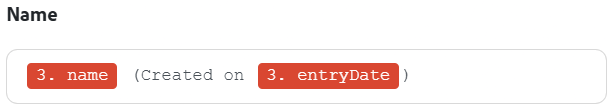
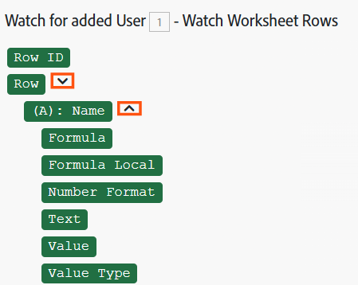

# 對應概觀

對應是將模組的輸出指派至其他模組之輸入欄位的程序。

模組的作業會產生零個、一個或多個組合包做為其輸出內容。 一個組合包內含一個或多個項目。

您可以將這些項目對應到之後模組的欄位中。

>[!NOTE]
>
>Workfront Fusion正在將案例編輯器轉換為新體驗。 在此轉換期間，傳統體驗和新體驗皆可使用，而且您可以隨時在它們之間切換。 我們建議您使用新體驗。 如需詳細資訊，請參閱文章「情境編輯器」中的[新體驗和傳統體驗](/help/workfront-fusion/get-started-with-fusion/navigate-fusion/scenario-editor.md#new-and-classic-experiences)。

當您按一下欄位，而您可以在該欄位中插入情境中前一個模組輸出的值時，對應面板便會顯示。 在這裡，您可以選取要對應的項目。 對應可能包括下列一個或多個項目：

* 單一項目
* 多個項目
* 靜態文字
* 函式

>[!BEGINSHADEBOX]

**範例**：

單一項目

包含文字的多個項目

包含多個項目和文字的函式

>[!ENDSHADEBOX]

如需有關對應的說明，請參閱[對應資料：文章索引](/help/workfront-fusion/create-scenarios/map-data/map-data-toc.md)下方的文章。

>[!NOTE]
>
>包覆在[!UICONTROL 疊代器]和[!UICONTROL 彙總器]流程之間的模組輸出，在[!UICONTROL 彙總器]模組以外無法存取。

## 對應面板

當您按一下可對應資料的欄位時，對應面板便會開啟。

第一個索引標籤會顯示您可以從其他模組對應的專案。

其他索引標籤包括可用於建立公式的函式、運算子和關鍵字。 而這些項目會根據所處理的資料類型，分類至不同的索引標籤中。

關於函式索引標籤的詳細資訊，請參閱[函式概觀](/help/workfront-fusion/get-started-with-fusion/understand-fusion/function-overview.md)。

如需使用函式對應專案的詳細資訊，請參閱[使用內建函式對應專案](/help/workfront-fusion/create-scenarios/map-data/map-using-functions.md)。

## 集合

項目可包含多個不同類型的值。 這些是集合類型的項目。

集合類型組合包會在模組輸出中的組合包標籤旁顯示 `(Collection)`。

在大多數情況下，您會對應集合的元素，而非對應代表整個集合的項目。

若要在對應面板中找出集合的元素，請按一下集合旁的箭頭。

關於集合的詳細資訊，請參閱[項目資料類型](/help/workfront-fusion/references/mapping-panel/data-types/item-data-types.md)。

關於對應集合的說明，請參閱「將一個模組的資訊對應到另一個模組」文章中的[對應項目](/help/workfront-fusion/create-scenarios/map-data/map-data-from-one-to-another.md#map-an-item)。

## 陣列

項目可包含多個相同類型的值。 這些是陣列類型的項目。

陣列類型組合包會在模組輸出中的組合包標籤旁顯示 `(Array)`。

在對映面板中，陣列會以方括弧顯示。 您可以藉由專案標籤結尾的方括弧來識別陣列型別專案。 若要在對應面板中找出特定的陣列元素，請按一下陣列旁的箭頭。

關於對應陣列與陣列元素的資訊和說明，請參閱[對應陣列與陣列元素](/help/workfront-fusion/create-scenarios/map-data/map-an-array.md)。
