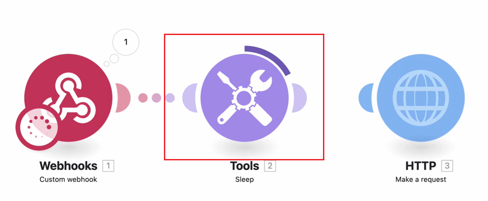
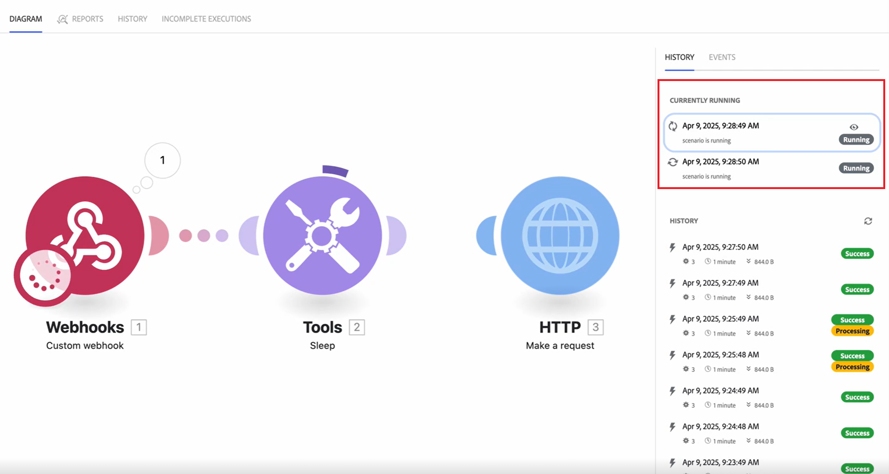

# 檢視執行中情境的資料流程

您可以觀看執行中的情境，以瞭解資料如何流經該情境。

>[!NOTE]
>
>Workfront Fusion正在將案例編輯器轉換為新體驗。 在此轉換期間，傳統體驗和新體驗皆可使用，而且您可以隨時在它們之間切換。 我們建議您使用新體驗。 如需詳細資訊，請參閱文章「情境編輯器」中的[新體驗和傳統體驗](/help/workfront-fusion/get-started-with-fusion/navigate-fusion/scenario-editor.md#new-and-classic-experiences)。

當案例執行時，使用中模組會在新體驗中模組圖示上以旋轉環標示，或在傳統體驗中模組周圍以增長環標示。 鈴聲只會顯示模組正在執行，而不會顯示其進度。 快速執行的模組可能只會顯示環的一小部分。

新體驗

新體驗中模組圖示上的

傳統體驗

執行模組後，輸出指示器隨即顯示。

新體驗

新體驗中的

傳統體驗

傳統體驗中的

如果模組處理多個組合，則每個已處理的組合都會出現環狀，而輸出指標會將其輸出的每個組合計算在內。

如需案例資料流程的詳細資訊，請參閱[案例執行流程](/help/workfront-fusion/references/scenarios/scenario-execution-flow.md)。

## 存取權要求

+++ 展開以檢視這篇文章中所述功能的存取權要求。

<table style="table-layout:auto">
 <col> 
 <col> 
 <tbody> 
  <tr> 
   <td role="rowheader">Adobe Workfront 封裝</td> 
   <td> 
任何 Adobe Workfront Workflow 封裝及任何 Adobe Workfront Automation and Integration 封裝

Workfront Ultimate

Workfront Prime 和 Select 封裝，以及額外購買的 Workfront Fusion。
 </td> 
  </tr> 
  <tr data-mc-conditions=""> 
   <td role="rowheader">Adobe Workfront 授權</td> 
   <td> 
標準

工作或更高層級
 </td> 
  </tr> 
  <tr> 
   <td role="rowheader">產品</td> 
   <td>
   
如果您的組織擁有 Select 或 Prime Workfront 封裝，但不包括 Workfront Automation and Integration，則您的組織必須購買 Adobe Workfront Fusion。</li></ul>
   </td> 
  </tr>
 </tbody> 
</table>

若要詳細了解此表格中的資訊，請參閱](/help/workfront-fusion/references/licenses-and-roles/access-level-requirements-in-documentation.md)文件中的存取權要求[。

+++

## 檢視執行中情境的資料流程

1. 按一下左側面板中的&#x200B;**[!UICONTROL 案例]**&#x200B;索引標籤。
1. 選取您要檢視資料流程的案例。
1. 按一下情境上的任何位置，以輸入情境編輯器。
1. 如果案例未執行，請啟動它或按一下&#x200B;**執行一次**&#x200B;以開始案例執行。
1. 選取您要在執行歷史記錄面板的「目前執行中」段落中檢視的執行。

