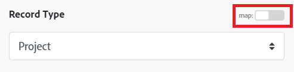

# Workfront Fusion模組

使用Workfront Fusion聯結器，您可以從情境中管理自己的Fusion組織。 有別於將Fusion連線至協力廠商應用程式或服務的其他聯結器，此聯結器可讓案例呼叫Fusion自己的API，其方式類似於Adobe Workfront聯結器讓案例管理Workfront的方式。

關於建立情境的說明，請參閱[建立情境：文章索引](/help/workfront-fusion/create-scenarios/create-scenarios-toc.md)之下的文章。

關於模組的資訊，請參閱[模組：文章索引](/help/workfront-fusion/references/modules/modules-toc.md)之下的文章。

## 存取權要求

+++ 展開以檢視這篇文章中所述功能的存取權要求。

<table style="table-layout:auto">
 <col> 
 <col> 
 <tbody> 
  <tr> 
   <td role="rowheader">Adobe Workfront 封裝</td> 
   <td> 
任何 Adobe Workfront Workflow 封裝及任何 Adobe Workfront Automation and Integration 封裝

Workfront Ultimate

Workfront Prime 和 Select 封裝，以及額外購買的 Workfront Fusion。
 </td> 
  </tr> 
  <tr data-mc-conditions=""> 
   <td role="rowheader">Adobe Workfront 授權</td> 
   <td> 
標準

工作或更高層級
 </td> 
  </tr> 
  <tr> 
   <td role="rowheader">產品</td> 
   <td>
   
如果您的組織擁有 Select 或 Prime Workfront 封裝，但不包括 Workfront Automation and Integration，則您的組織必須購買 Adobe Workfront Fusion。</li></ul>
   </td> 
  </tr>
 </tbody> 
</table>

若要詳細了解此表格中的資訊，請參閱[&#128279;](/help/workfront-fusion/references/licenses-and-roles/access-level-requirements-in-documentation.md)文件中的存取權要求。

+++

## 將Workfront Fusion連線至Workfront Fusion

1. 在任何Workfront Fusion模組中，按一下「連線」欄位旁的&#x200B;**[!UICONTROL 新增]**。
1. 填寫下列欄位：

   <table style="table-layout:auto"> 
    <col> 
    <col> 
    <tbody> 
     <tr> 
      <td role="rowheader">[!UICONTROL 連線類型]</td> 
      <td>Select您要建立的連線型別。</td> 
     </tr> 
     <tr> 
      <td role="rowheader">[!UICONTROL 連線名稱]</td> 
      <td>輸入此連線的名稱。</td> 
     </tr> 
     <tr> 
      <td role="rowheader">[!UICONTROL 用戶端 ID]</td> 
      <td>輸入您的 [!DNL Adobe] [!UICONTROL 用戶端 ID]。 這可以在[!DNL Adobe Developer Console]的[!UICONTROL Credentials]詳細資訊區段中找到。</td> 
     </tr> 
     <tr> 
      <td role="rowheader">[!UICONTROL 用戶端密碼]</td> 
      <td>輸入您的 [!DNL Adobe] [!UICONTROL 用戶端密碼]。 這可以在[!DNL Adobe Developer Console]的[!UICONTROL Credentials]詳細資訊區段中找到。</td> 
     </tr> 
     <tr> 
      <td role="rowheader">[!UICONTROL 組織ID]</td> 
      <td>輸入您的[!DNL Adobe] IMS組織ID。</td> 
     </tr> 
     <tr> 
      <td role="rowheader">[!UICONTROL 區域]</td> 
      <td>此連線的Fusion區域Select。</td> 
     </tr> 
    </tbody> 
   </table>

1. 按一下「**[!UICONTROL 繼續]**」，儲存連線並返回模組。

## Workfront Fusion模組及其欄位

當您設定Workfront Fusion模組時，Workfront Fusion會顯示下列欄位。 在模組中，粗體標題表示那是必要欄位。

若在欄位或函式上方看到對應按鈕，可以使用按鈕設定該欄位的變數和函式。 如需詳細資訊，請參閱[將資訊從一個模組對應到另一個模組](/help/workfront-fusion/create-scenarios/map-data/map-data-from-one-to-another.md)。

* [觸發程序](#triggers)
* [動作](#actions)
* [匯出](#export)
* [雜項](#misc)

### 觸發程序

* [觀看記錄](#watch-records)

#### 觀看記錄

此觸發模組會在Workfront Fusion記錄建立、更新或兩者同時建立時啟動案例。 您可以使用篩選器來著重處理對團隊而言重要的變更，因此不必手動檢查Workfront Fusion。

<table style="table-layout:auto"> 
 <col> 
 <col> 
 <tbody> 
  <tr> 
   <td role="rowheader">[!UICONTROL 連線]</td> 
   <td> 
如需有關將Workfront Fusion連線到Workfront Fusion的說明，請參閱本文中的<a href="#connect-workfront-fusion-to-workfront-fusion" class="MCXref xref">將Workfront Fusion連線到Workfront Fusion</a>。
 </td> 
  </tr> 
  <tr> 
   <td role="rowheader">觀看</td> 
   <td>Select您要模組留意的變更型別。</td> 
  </tr> 
  <tr> 
   <td role="rowheader">記錄類型</td> 
   <td>Select您要觀看的記錄型別： <b>案例</b>或<b>執行</b>。</td> 
  </tr> 
  <tr> 
   <td role="rowheader">案例ID</td> 
   <td>
如果您正在監視執行，請選取或對應您要監視執行的情境。

此欄位為選用。 如果您將其留空，則模組會在整個組織中搜尋執行。
</td> 
  </tr> 
  <tr> 
   <td role="rowheader">顯示檢查回合</td> 
   <td>
如果您正在觀看執行，請選取結果是否包含檢查執行：
<ul><li><b>是</b>：包含檢查執行。</li><li><b>否</b>：不包含檢查回合。</li><li><b>未定義</b>：不要依據檢查執行來篩選結果。</li></ul></td> 
  </tr> 
  <tr> 
   <td role="rowheader">篩選</td> 
   <td>在<b>屬性</b>下，針對您要使用的每個屬性篩選，按一下<b>新增專案</b>，選取欄位和運運算元，然後輸入或對應您要篩選的值。 值欄位僅會對需要它的運運算元顯示。 例如，<b>Exists</b>之類的運運算元不需要值。 Scenario和Execution記錄型別的屬性篩選器相同。</td> 
  </tr> 
  <tr> 
   <td role="rowheader">限制</td> 
   <td>輸入或對映Workfront Fusion在一個執行週期內可處理的最大結果數量。 預設值為200。</td> 
  </tr> 
 </tbody> 
</table>

### 動作

* [複製記錄](#clone-a-record)
* [建立記錄](#create-a-record)
* [刪除記錄](#delete-a-record)
* [清單記錄](#list-records)
* [讀取記錄](#read-a-record)
* [更新記錄](#update-a-record)

#### 複製記錄

此模組會製作指定記錄的復本。

<table style="table-layout:auto"> 
 <col> 
 <col> 
 <tbody> 
  <tr> 
   <td role="rowheader">[!UICONTROL 連線]</td> 
   <td> 
如需有關將Workfront Fusion連線到Workfront Fusion的說明，請參閱本文中的<a href="#connect-workfront-fusion-to-workfront-fusion" class="MCXref xref">將Workfront Fusion連線到Workfront Fusion</a>。
 </td> 
  </tr> 
  <tr> 
   <td role="rowheader">記錄類型</td> 
   <td> Select您要複製的記錄型別。 </td> 
  </tr> 
  <tr> 
   <td role="rowheader">案例ID /勾點ID /資料結構ID</td> 
   <td> 輸入或對應您要複製的專案識別碼。 </td> 
  </tr> 
  <tr> 
   <td role="rowheader">名稱</td> 
   <td> 輸入或對應新案例、連結或資料結構的名稱。</td> 
  </tr> 
 </tbody> 
</table>

#### 建立記錄

此模組會使用指定的資料建立記錄。

<table style="table-layout:auto"> 
 <col> 
 <col> 
 <tbody> 
  <tr> 
   <td role="rowheader">[!UICONTROL 連線]</td> 
   <td> 
如需有關將Workfront Fusion連線到Workfront Fusion的說明，請參閱本文中的<a href="#connect-workfront-fusion-to-workfront-fusion" class="MCXref xref">將Workfront Fusion連線到Workfront Fusion</a>。
 </td> 
  </tr> 
  <tr> 
   <td role="rowheader">記錄類型</td> 
   <td> 選取您要建立的記錄類型。 </td> 
  </tr> 
  <tr> 
   <td role="rowheader">團隊 ID</td> 
   <td> 輸入或對應將擁有此記錄的團隊ID。 </td> 
  </tr> 
  <tr> 
   <td role="rowheader">名稱</td> 
   <td> 輸入或對應新記錄的名稱。</td> 
  </tr> 
 </tbody> 
</table>

#### 刪除記錄

此模組會刪除指定的記錄。

<table style="table-layout:auto"> 
 <col> 
 <col> 
 <tbody> 
  <tr> 
   <td role="rowheader">[!UICONTROL 連線]</td> 
   <td> 
如需有關將Workfront Fusion連線到Workfront Fusion的說明，請參閱本文中的<a href="#connect-workfront-fusion-to-workfront-fusion" class="MCXref xref">將Workfront Fusion連線到Workfront Fusion</a>。
 </td> 
  </tr> 
  <tr> 
   <td role="rowheader">記錄類型</td> 
   <td> 選取您要刪除的記錄型別。 </td> 
  </tr> 
  <tr> 
   <td role="rowheader">其他欄位</td> 
   <td>輸入任何其他欄位的值。 可用欄位取決於所選的記錄型別。 </td> 
  </tr> 
 </tbody> 
</table>

#### 清單記錄

此模組會使用游標式分頁與屬性篩選器，傳回分頁記錄清單。

<table style="table-layout:auto"> 
 <col> 
 <col> 
 <tbody> 
  <tr> 
   <td role="rowheader">[!UICONTROL 連線]</td> 
   <td> 
如需有關將Workfront Fusion連線到Workfront Fusion的說明，請參閱本文中的<a href="#connect-workfront-fusion-to-workfront-fusion" class="MCXref xref">將Workfront Fusion連線到Workfront Fusion</a>。
 </td> 
  </tr> 
  <tr> 
   <td role="rowheader">記錄類型</td> 
   <td>選取您要傳回清單的記錄型別。</td> 
  </tr> 
  <tr> 
   <td role="rowheader">欄位</td> 
   <td>選取要包含在結果中的任何欄位。</td> 
  </tr> 
  <tr> 
   <td role="rowheader">屬性</td> 
   <td>針對您要傳回結果的每個屬性篩選器，按一下<b>新增專案</b>，然後輸入您要篩選的欄位、運運算元和值。</td> 
  </tr> 
  <tr> 
   <td role="rowheader">開始</td> 
   <td>輸入您要開始傳回結果的位置。 這是用於分頁。</td> 
  </tr> 
  <tr> 
   <td role="rowheader">傳回結果的最大數量</td> 
   <td>輸入或對應您希望模組在每個執行週期傳回的最大記錄數。</td> 
  </tr> 
  <tr> 
   <td role="rowheader">排序依據</td> 
   <td>選取您要依據排序結果的欄位。</td> 
  </tr> 
  <tr> 
   <td role="rowheader">方向</td> 
   <td>選取您要以遞增或遞減方式排序結果。</td> 
  </tr> 
 </tbody> 
</table>

#### 讀取記錄

此模組會擷取指定的記錄

<table style="table-layout:auto"> 
 <col> 
 <col> 
 <tbody> 
  <tr> 
   <td role="rowheader">[!UICONTROL 連線]</td> 
   <td> 
如需有關將Workfront Fusion連線到Workfront Fusion的說明，請參閱本文中的<a href="#connect-workfront-fusion-to-workfront-fusion" class="MCXref xref">將Workfront Fusion連線到Workfront Fusion</a>。
 </td> 
  </tr> 
  <tr> 
   <td role="rowheader">記錄類型</td> 
   <td> 選取您要刪除的記錄型別。 </td> 
  </tr> 
  <tr> 
   <td role="rowheader">其他欄位</td> 
   <td>輸入任何其他欄位的值。 可用欄位取決於所選的記錄型別。 </td> 
  </tr> 
 </tbody> 
</table>

#### 更新記錄

更新指定的記錄。

<table style="table-layout:auto"> 
 <col> 
 <col> 
 <tbody> 
  <tr> 
   <td role="rowheader">[!UICONTROL 連線]</td> 
   <td> 
如需有關將Workfront Fusion連線到Workfront Fusion的說明，請參閱本文中的<a href="#connect-workfront-fusion-to-workfront-fusion" class="MCXref xref">將Workfront Fusion連線到Workfront Fusion</a>。
 </td> 
  </tr> 
  <tr> 
   <td role="rowheader">記錄類型</td> 
   <td> Select您要更新的記錄型別。 </td> 
  </tr> 
  <tr> 
   <td role="rowheader">名稱</td> 
   <td> 輸入或對映記錄的新名稱。</td> 
  </tr> 
  <tr> 
   <td role="rowheader">ID</td> 
   <td> 輸入或對應您要更新的記錄ID。 </td> 
  </tr> 
 </tbody> 
</table>

### 匯出

* [匯出活動記錄](#export-activity-logs)
* [匯出案例](#export-scenarios)

#### 匯出活動記錄

此模組會匯出活動記錄。

<table style="table-layout:auto"> 
 <col> 
 <col> 
 <tbody> 
  <tr> 
   <td role="rowheader">[!UICONTROL 連線]</td> 
   <td> 
如需有關將Workfront Fusion連線到Workfront Fusion的說明，請參閱本文中的<a href="#connect-workfront-fusion-to-workfront-fusion" class="MCXref xref">將Workfront Fusion連線到Workfront Fusion</a>。
 </td> 
  </tr> 
  <tr> 
   <td role="rowheader">檔案類型</td> 
   <td>Select您要匯出記錄檔的檔案格式。</td> 
  </tr> 
  <tr> 
   <td role="rowheader">屬性</td> 
   <td>針對您要傳回結果的每個屬性篩選器，按一下<b>新增專案</b>，然後輸入您要篩選的欄位、運運算元和值。 您也可以依欄位是否存在來篩選。</td> 
  </tr> 
  <tr> 
   <td role="rowheader">開始</td> 
   <td>輸入您要開始傳回結果的位置。 這是用於分頁。</td> 
  </tr> 
  <tr> 
   <td role="rowheader">傳回結果的最大數量</td> 
   <td>輸入或對應您希望模組在每個執行週期傳回的最大記錄數。</td> 
  </tr> 
  <tr> 
   <td role="rowheader">排序依據</td> 
   <td>選取您要依據排序結果的欄位。</td> 
  </tr> 
  <tr> 
   <td role="rowheader">方向</td> 
   <td>選取您要以遞增或遞減方式排序結果。</td> 
  </tr> 
 </tbody> 
</table>

#### 匯出案例

此模組會匯出一或多個案例的Fusion Blueprint。

<table style="table-layout:auto"> 
 <col> 
 <col> 
 <tbody> 
  <tr> 
   <td role="rowheader">[!UICONTROL 連線]</td> 
   <td> 
如需有關將Workfront Fusion連線到Workfront Fusion的說明，請參閱本文中的<a href="#connect-workfront-fusion-to-workfront-fusion" class="MCXref xref">將Workfront Fusion連線到Workfront Fusion</a>。
 </td> 
  <tr> 
   <td role="rowheader">案例ID</td> 
   <td>針對您想要匯出的每個案例，按一下<b>新增專案</b>並輸入案例識別碼。</td> 
  </tr> 
  </tr> 
 </tbody> 
</table>

### 雜項

* [取得掛接的佇列統計資料](#get-queue-statistics-for-a-hook)
* [取得記錄相依性](#get-record-dependencies)
* [列出連線的案例](#list-scenarios-for-a-connection)
* [列出Fusion區域和組織](#list-the-fusion-regions-and-organizations)

#### 取得掛接的佇列統計資料

此模組會傳回指定掛接的佇列統計資料：目前佇列的事件數、佇列限制，以及掛接是否已啟用。

<table style="table-layout:auto"> 
 <col> 
 <col> 
 <tbody> 
  <tr> 
   <td role="rowheader">[!UICONTROL 連線]</td> 
   <td> 
如需有關將Workfront Fusion連線到Workfront Fusion的說明，請參閱本文中的<a href="#connect-workfront-fusion-to-workfront-fusion" class="MCXref xref">將Workfront Fusion連線到Workfront Fusion</a>。
 </td> 
  <tr> 
   <td role="rowheader">勾點ID</td> 
   <td> 輸入或對應您要傳回詳細資訊之連結的ID。</td> 
  </tr> 
 </tbody> 
</table>

#### 取得記錄相依性

此模組取得記錄的相依性。

<table style="table-layout:auto"> 
 <col> 
 <col> 
 <tbody> 
  <tr> 
   <td role="rowheader">[!UICONTROL 連線]</td> 
   <td> 
如需有關將Workfront Fusion連線到Workfront Fusion的說明，請參閱本文中的<a href="#connect-workfront-fusion-to-workfront-fusion" class="MCXref xref">將Workfront Fusion連線到Workfront Fusion</a>。
 </td> 
  <tr> 
   <td role="rowheader">記錄類型</td> 
   <td> Select您要擷取相依性的記錄型別。 </td> 
  </tr> 
  <tr> 
   <td role="rowheader">案例ID/勾點ID</td> 
   <td> 輸入或對應您要擷取相依性的記錄ID。 </td> 
  </tr> 
  </tr> 
 </tbody> 
</table>

#### 取得記錄相依專案

此模組會識別依賴指定資源的專案。 在刪除資源之前使用此模組，以檢查是否有任何內容依賴該資源且可能受其刪除影響。

<table style="table-layout:auto"> 
 <col> 
 <col> 
 <tbody> 
  <tr> 
   <td role="rowheader">[!UICONTROL 連線]</td> 
   <td> 
如需有關將Workfront Fusion連線到Workfront Fusion的說明，請參閱本文中的<a href="#connect-workfront-fusion-to-workfront-fusion" class="MCXref xref">將Workfront Fusion連線到Workfront Fusion</a>。
 </td> 
  </tr> 
  <tr> 
   <td role="rowheader">記錄類型</td> 
   <td>Select您要檢查相依項的記錄型別。</td> 
  </tr> 
  <tr> 
   <td role="rowheader">種類</td> 
   <td>Select是您要檢查的相依性種類……</td> 
  </tr> 
  <tr> 
   <td role="rowheader">ID</td> 
   <td>輸入或對應您要傳回相依項的記錄ID。</td> 
  </tr> 
 </tbody> 
</table>

#### 列出連線的案例

此模組會傳回參考指定連線的案例分頁清單。

<table style="table-layout:auto"> 
 <col> 
 <col> 
 <tbody> 
  <tr> 
   <td role="rowheader">[!UICONTROL 連線]</td> 
   <td> 
如需有關將Workfront Fusion連線到Workfront Fusion的說明，請參閱本文中的<a href="#connect-workfront-fusion-to-workfront-fusion" class="MCXref xref">將Workfront Fusion連線到Workfront Fusion</a>。
 </td> 
  </tr> 
  <tr> 
   <td role="rowheader">連線ID</td> 
   <td>輸入或對應您要傳回案例的連線ID。</td> 
  </tr> 
  <tr> 
   <td role="rowheader">屬性</td> 
   <td>針對您要傳回結果的每個屬性篩選器，按一下<b>新增專案</b>，然後輸入您要篩選的欄位、運運算元和值。 您也可以依欄位是否存在來篩選。</td> 
  </tr> 
  <tr> 
   <td role="rowheader">開始</td> 
   <td>輸入您要開始傳回結果的位置。 這是用於分頁。</td> 
  </tr> 
  <tr> 
   <td role="rowheader">傳回結果的最大數量</td> 
   <td>輸入或對應您希望模組在每個執行週期傳回的最大記錄數。</td> 
  </tr> 
  <tr> 
   <td role="rowheader">排序依據</td> 
   <td>選取您要依據排序結果的欄位。</td> 
  </tr> 
  <tr> 
   <td role="rowheader">方向</td> 
   <td>選取您要以遞增或遞減方式排序結果。</td> 
  </tr> 
 </tbody> 
</table>

#### 列出Fusion區域和組織

此模組會根據連線中所使用認證的IMS使用者設定檔中的認證和存取權，傳回連線可存取之每個Fusion組織的地區和組織ID。

<table style="table-layout:auto"> 
 <col> 
 <col> 
 <tbody> 
  <tr> 
   <td role="rowheader">[!UICONTROL 連線]</td> 
   <td> 
如需有關將Workfront Fusion連線到Workfront Fusion的說明，請參閱本文中的<a href="#connect-workfront-fusion-to-workfront-fusion" class="MCXref xref">將Workfront Fusion連線到Workfront Fusion</a>。
 </td> 
  </tr> 
 </tbody> 
</table>
